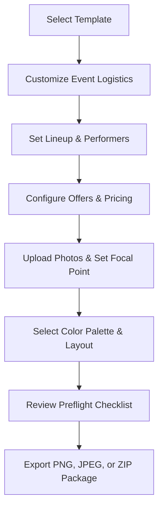

# Ozone Lounge Poster Generator — Operator Quick Start Guide

**Version**: 1.0.0  
**Target Audience**: Ozone Lounge Marketing Operators & Floor Managers  
**Supported Devices**: Mobile Smartphones (iOS Safari / Android Chrome), Tablets, Desktop Browsers

---

## 1. Introduction

The **Ozone Lounge Poster Generator** enables lounge operators to create polished, high-resolution event posters for weekly nightclub schedules without requiring graphic design software. 

The application enforces a strictly curated design system across all **seven weekly event templates**, ensuring brand consistency while allowing flexibility in dates, timings, DJ lineups, host assignments, and promotional drink offers.

---

## 2. Getting Started & Sign In

1. Open your mobile browser (Safari on iPhone, Chrome on Android) and navigate to the application URL:
   ```
   https://posters.ozonelounge.com  (or http://localhost:3005 in local development)
   ```
2. Enter your authorized operator credentials:
   - **Email**: `operator@ozonelounge.com` (or your assigned operator email)
   - **Password**: Your secure password
3. Tap **Sign In**.
4. Upon successful authentication, you will be directed to the **Weekly Template Gallery**.

---

## 3. The Seven Weekly Templates

Posters are organized by day of the week to align with Ozone Lounge's recurring entertainment schedule:

| Day | Template Name | Event Theme | Default Lineup / Offer Highlight |
| :--- | :--- | :--- | :--- |
| **Monday** | **Reddington** | *Old Classics & Sundowners* | Resident: Monsieur Pierre · Sunset Ember palette · Discount offer |
| **Tuesday** | **Saint** | *African Night (Afro)* | Afrobeat rhythms · Duo lineup: DJ Neb & DVJ Jojez · Saffron & Ink |
| **Wednesday** | **Lannister** | *Groovy Wednesday* | Mid-week energy · DJ Donben & DJ Vin · Disco punch neon style |
| **Thursday** | **Shelby** | *Karaoke Night* | Hosts: Bellah Harriet & Tito Wagithomo · DJ Fab · Spotlight stage |
| **Friday** | **Lothbrok** | *Flight Fridays* | High-energy weekend kickoff · DJ Slim D & Mistabrand · No drink offers |
| **Saturday** | **Escobar** | *Saturday Fiesta* | Peak weekend fiesta · DVJ Jojez · Bold midnight party vibes |
| **Sunday** | **Pinkman** | *Old Skool Sundays* | Vintage retro vinyl finale · DJ Ngash · Vinyl badge accent |

---

## 4. Step-by-Step Creation Workflow



### Step 1: Select a Template
- On the Gallery screen, swipe horizontally or scroll vertically through the 7 template cards.
- Tap **Use Template** on the day you wish to produce.

### Step 2: Edit Event Details & Logistics
- **Event Title**: Pre-filled with the weekly theme; editable if hosting a special edition.
- **Date Text**: Enter the specific date (e.g., `Monday, 24 October 2026`).
- **Start Time**: Enter the door opening or showtime (e.g., `4:00 PM - Late`).
- **Venue Name & Contact**: Defaults to `Ozone Lounge`; custom contact phone or VIP reservation line can be added.

> [!NOTE]
> **No Invented Placeholder Copy**: If you leave the Date or Time field blank, the poster will cleanly omit that block rather than displaying dummy placeholder text like "TBD" or "Lorem Ipsum".

### Step 3: Configure Lineup & Hosts
- **DJs / Performers**: Tap **Add DJ** to enter resident and guest artists. Tap the trash icon to remove any entries.
- **Hosts (Thursday Shelby)**: Shelby includes dedicated host input fields. Hosts and DJs are automatically separated into their respective visual badges on the poster.

### Step 4: Add Promotional Drink Offers
- **Primary Offer**: Enter happy hour or special bottle pricing (e.g., `Discounts on all drinks, excluding wine`).
- **Friday Rule (Flight Fridays)**: Per lounge operating policy, Friday templates default to offer-free compositions.

### Step 5: Upload Background Imagery & Position Focal Points
1. In the **Media Assets** panel, tap **Upload Photo**.
2. Select a photo from your device camera roll or take a new photo.
3. Once uploaded, use the **Focal Point Controller**:
   - Tap or drag the crosshair indicator to pinpoint the visual focal point (e.g., the DJ's face or the center of the lounge stage).
   - The master 4:5 canvas automatically aligns and frames the image based on your focal coordinate.

### Step 6: Curate Styling (Palettes & Layouts)
- Tap the **Style** tab in the editor:
  - **Color Palette**: Choose between 3 curated brand palettes designed for that day's mood.
  - **Typography**: Select between dramatic headline or modern condensed typography pairings.
  - **Layout Mode**: Toggle layout options (e.g., Full Bleed Sunset vs. Vinyl Anchor).

---

## 5. Saving Drafts & Template Safety Guard

- **Autosave**: Changes are continuously tracked in your browser session.
- **Manual Save**: Tap the **Save Draft** button in the top navigation bar at any time. Saved drafts can be reopened from the **My Drafts** gallery tab.
- **Template Switching Guard**:
  - If you tap the template picker while having unsaved edits, an alert dialog will appear:
    > *"Switching templates will reset your layout-specific styling. Do you wish to continue?"*
  - Choose **Continue** to switch or **Cancel** to keep your existing work.

---

## 6. Preflight Inspection Checklist

Before exporting, the system automatically runs a preflight check:
- **Green Checks**: All recommended fields are complete.
- **Yellow Warnings**: Missing Date or Time information. You may still proceed with export if an undated promotional flyer is intended.
- **Red Errors**: Missing required asset or invalid text length.

---

## 7. Exporting & Sharing

1. Tap the **Export** button in the header.
2. Select your desired export format:
   - **PNG (Master)**: Lossless quality, 1080 × 1350 px (4:5 portrait). Best for archival master prints and high-fidelity displays.
   - **JPEG High (0.85)**: Compressed for rapid social media uploading (Instagram & Facebook feeds).
   - **Export All Days (.ZIP)**: Generates a compressed archive containing all 7 weekly posters named according to brand standard:
     `Ozone-Lounge-[Day]-[Template]-[Title]-[Date].[ext]`
3. **Sharing to Social Media**:
   - On compatible mobile devices (iPhone Safari / Android Chrome), tapping **Share** triggers the native system share sheet, allowing you to send the poster directly to Instagram, WhatsApp, or AirDrop.
   - On desktop browsers, the poster downloads directly to your device storage.

---

## 8. Troubleshooting & Frequently Asked Questions

**Q: My photo looks cropped strangely on mobile.**  
A: Open the **Media** tab in the editor and adjust the **Focal Point crosshair**. Moving the point toward the subject's face ensures the crop keeps them centered.

**Q: Can I change the poster size to 9:16 (Instagram Story)?**  
A: Version 1.0.0 is strictly calibrated to the standard 4:5 feed aspect ratio (1080 × 1350 px). Story formats are planned for a subsequent update.

**Q: What if I lose internet connection while editing?**  
A: Keep your browser tab open. Your current edits remain loaded in the editor. Once connectivity is restored, tap **Save Draft** to synchronize with the server.
